# haris18s/markerphylo


[](https://www.nextflow.io/)
[](https://github.com/nf-core/tools/releases/tag/4.1.0)
[](https://docs.conda.io/en/latest/)
[](https://www.docker.com/)
[](https://sylabs.io/docs/)

> [!NOTE]
> **Status: work in progress.** The core workflow from genomes to a concatenated marker alignment is implemented. Species tree inference is being integrated; tests and the extensions listed below are planned.

## Introduction

**haris18s/markerphylo** is a Nextflow pipeline for **marker-based phylogenomics of bacterial genomes**. It takes NCBI assembly accessions and/or local genome assemblies (isolates or MAGs), identifies conserved single-copy marker genes in each genome, aligns and trims each marker across all genomes, and concatenates them into a supermatrix for species tree inference.

The approach follows established marker-based phylogenomic workflows (e.g. [GToTree](https://github.com/AstrobioMike/GToTree), [PhyloPhlAn](https://github.com/biobakery/phylophlan), and the methods in [Hugoson et al. 2022](https://doi.org/10.1093/molbev/msac037)), implemented as a modular Nextflow pipeline built on the nf-core template. Each step runs in its own container, scales across genomes on HPC, can be resumed, and is designed to be extended with gene-content and horizontal gene transfer (HGT) analyses.

## Pipeline Overview

```mermaid
flowchart LR
    A[Samplesheet] --> B[NCBI download / local FASTA]
    B --> C[CheckM2 genome QC]
    C --> D[Pyrodigal gene calling]
    D --> E[HMMER marker search]
    E --> F[Select markers per genome]
    F --> G[Merge per marker]
    G --> H[MAFFT alignment]
    H --> I[ClipKIT trimming]
    I --> J[SeqKit concatenation]
    J -.-> K[IQ-TREE species tree]
```



1. **Input:** genomes from NCBI accessions ([`ncbi-genome-download`](https://github.com/kblin/ncbi-genome-download)) and/or local assembly FASTA files
2. **Genome QC:** completeness and contamination estimates ([`CheckM2`](https://github.com/chklovski/CheckM2)); can be skipped with `--skip_qc`
3. **Gene calling:** protein prediction ([`Pyrodigal`](https://github.com/althonos/pyrodigal))
4. **Marker search:** single-copy marker genes with profile HMMs ([`HMMER`](http://hmmer.org/) `hmmsearch`, using curated Pfam gathering thresholds `--cut_ga`)
5. **Marker selection** (custom script): one protein per marker and genome. Markers with multiple hits are excluded by default (possible paralogs or contamination), or the best-scoring hit is kept with `--best_hit`
6. **Merge:** regroup sequences into one FASTA per marker across all genomes
7. **Alignment:** per-marker alignment with [`MAFFT`](https://mafft.cbrc.jp/alignment/software/) (L-INS-i)
8. **Trimming:** [`ClipKIT`](https://github.com/JLSteenwyk/ClipKIT)
9. **Concatenation:** supermatrix of all markers ([`SeqKit`](https://bioinf.shenwei.me/seqkit/) `concat`), with missing markers filled as gaps
10. **Species tree:** maximum-likelihood tree with [`IQ-TREE`](http://www.iqtree.org/) (ModelFinder, ultrafast bootstrap) *(being integrated)*

### Samplesheet

Each row is one genome, given **either** as an NCBI assembly accession **or** as a local assembly FASTA:

```csv
sample,accession,fasta
L_pneumophila,GCF_000008485.1,
L_longbeachae,,/path/to/L_longbeachae.fna
```

- `sample`: unique name without spaces; used as the label in alignments and the tree
- `accession`: NCBI assembly accession (`GCF_...` or `GCA_...`)
- `fasta`: path to an assembled genome (`.fa`, `.fasta`, `.fna`, optionally `.gz`)

The pipeline starts from **assembled** genomes. For raw reads, assemble first, e.g. with [nf-core/bacass](https://nf-co.re/bacass) (isolates) or [nf-core/mag](https://nf-co.re/mag) (metagenomes).

### Reference data

- **Marker set (`--markers_hmm`):** a profile HMM file of single-copy marker genes, e.g. the [GToTree SCG sets](https://github.com/AstrobioMike/GToTree/wiki/SCG-sets) (`Gammaproteobacteria.hmm`, `Proteobacteria.hmm`, `Bacteria.hmm`). Choose a set that covers all genomes in the dataset, including outgroups.
- **CheckM2 database (`--checkm2_db`):** the CheckM2 DIAMOND database (`.dmnd`), downloaded once with `checkm2 database --download`. Not needed with `--skip_qc`.

### Running the pipeline

Parameters can be provided in a file, e.g. `params.yaml`:

```yaml
input: samplesheet.csv
outdir: results
markers_hmm: /path/to/Gammaproteobacteria.hmm
checkm2_db: /path/to/CheckM2_database/uniref100.KO.1.dmnd
```

```bash
nextflow run haris18s/markerphylo \
   -params-file params.yaml \
   -profile docker
```

Use `-profile singularity` or `-profile conda` as alternatives to Docker, and add `-resume` to continue a previous run.

| Parameter | Description | Default |
|---|---|---|
| `--input` | Samplesheet (CSV) | required |
| `--outdir` | Output directory | required |
| `--markers_hmm` | Marker profile HMM file | required |
| `--checkm2_db` | CheckM2 database | required unless `--skip_qc` |
| `--skip_qc` | Skip CheckM2 genome QC | `false` |
| `--best_hit` | Keep the best-scoring hit for multi-copy markers instead of excluding them | `false` |

## Planned extensions

- **Species tree output and visualisation**, with partitioned models per marker
- **Gene-tree QC and discordance report:** per-marker gene trees compared with the species tree, flagging markers with discordant histories as candidates for paralogy or HGT
- **Genome filtering** by fraction of markers recovered
- **Gene content evolution:** gene family clustering and gain/loss reconstruction along the species tree
- **HGT screening:** candidate detection against databases including eukaryotes and Asgard archaea, confirmed with gene trees
- **Tests** with nf-test and continuous integration

## Credits

haris18s/markerphylo was written by Haris Spyridis ([@haris18s](https://github.com/haris18s)).

## Citations

This pipeline builds on the tools listed above; please cite them if you use it. Marker sets are from GToTree:

> Lee MD. GToTree: a user-friendly workflow for phylogenomics. *Bioinformatics* 35, 4162–4164 (2019).

This pipeline uses code and infrastructure developed and maintained by the [nf-core](https://nf-co.re) community, reused here under the [MIT license](https://github.com/nf-core/tools/blob/main/LICENSE).

> **The nf-core framework for community-curated bioinformatics pipelines.**
>
> Philip Ewels, Alexander Peltzer, Sven Fillinger, Harshil Patel, Johannes Alneberg, Andreas Wilm, Maxime Ulysse Garcia, Paolo Di Tommaso & Sven Nahnsen.
>
> _Nat Biotechnol._ 2020 Feb 13. doi: [10.1038/s41587-020-0439-x](https://dx.doi.org/10.1038/s41587-020-0439-x).